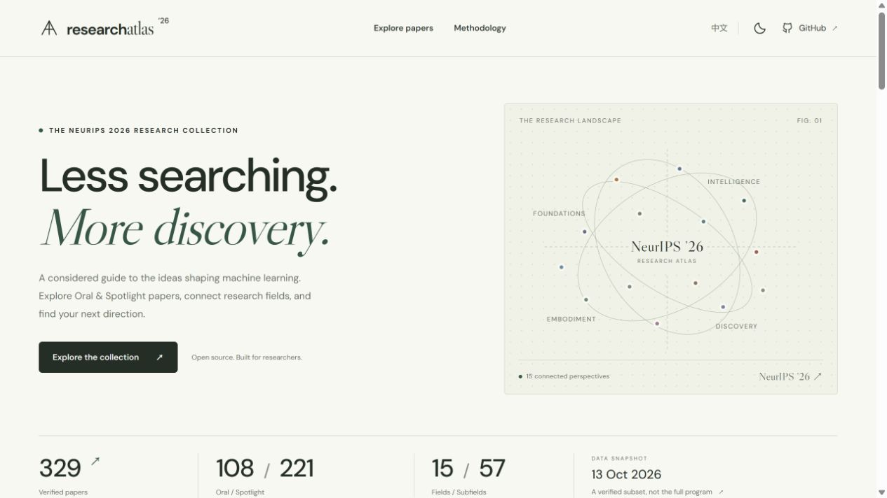
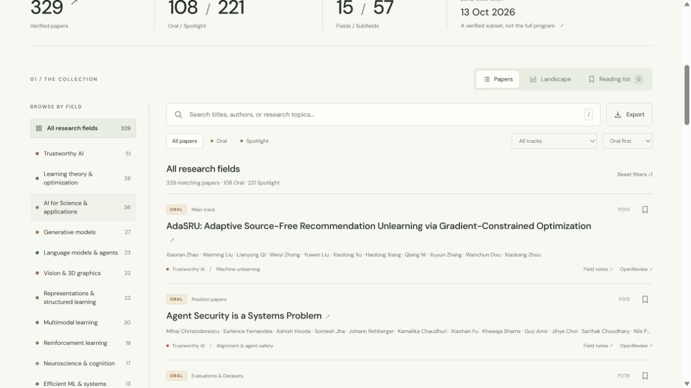
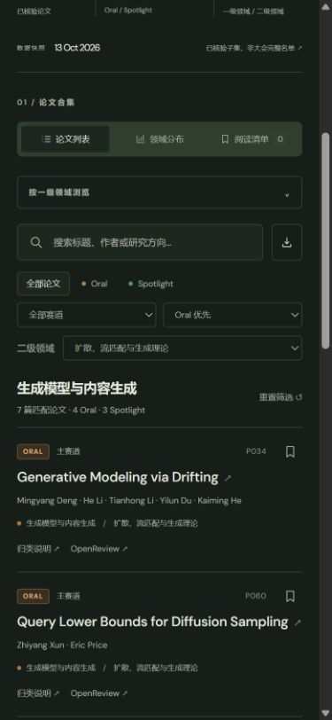

<div align="center">


# NeurIPS ’26 · Research Atlas

### Less searching. More discovery.

A field guide to **329 verified Oral & Spotlight papers**, organized around the questions researchers actually ask.

[](https://periodblue.github.io/neurips-2026-research-atlas/)
[](site/data/papers.json)
[](#research-landscape)
[](LICENSE)

[**Open the website ↗**](https://periodblue.github.io/neurips-2026-research-atlas/) · [Download data](site/data/papers_classified.csv) · [Methodology](#scope--methodology) · [Contribute](CONTRIBUTING.md) · [中文](README.zh-CN.md)

</div>

<a href="https://periodblue.github.io/neurips-2026-research-atlas/">
  
</a>

> **Know the boundary before using the numbers.** This is a verified **public subset**, not the complete NeurIPS 2026 acceptance list. The snapshot is dated **13 October 2026**. Research fields are analyst-assigned; presentation decisions come from official program data. See [scope and provenance](#scope--methodology).

## Built for the research workflow

You may be starting a literature review, preparing a reading group, comparing adjacent directions, or looking for the next paper worth a careful read. Research Atlas brings the field overview and the paper-level evidence into one place.

| Research question | A useful place to start |
| --- | --- |
| What is happening in my area? | Select a primary field, then narrow to a subfield. |
| Which main-track Orals should our group read? | Select **Main track → Oral**, then browse or search. |
| What is happening just outside my topic? | Open **Landscape** and follow a neighboring research field. |
| Why is this paper in this category? | Open **Field notes** for its classification and source decision. |
| How can I build a reading plan? | Bookmark papers and export your reading list as Markdown or CSV. |
| Can I share an exact selection? | Copy the filtered page URL, or use **Copy paper link** in a paper’s field notes. |

## What you can do

- **Navigate two levels of research topics.** 15 primary fields and 57 subfields, with one primary assignment per paper to avoid double-counting.
- **Go directly to the evidence.** Every title opens its official paper page. Every record also links to OpenReview.
- **Search across titles, authors, and topics.** Both English and Chinese taxonomy labels are searchable.
- **Separate presentation types and tracks.** Oral / Spotlight; Main / Evaluations & Datasets / Position.
- **See the distribution.** The Landscape view updates with your current filters and exposes subfield counts.
- **Keep a private reading list.** Bookmarks stay in your browser. No account, backend, or analytics.
- **Export what you see.** Download filtered CSV data or a Markdown reading checklist.
- **Read comfortably.** English / 中文, light / dark, mobile layouts, keyboard search with `/`, and native accessible dialogs.

The homepage illustration is a conceptual field atlas, **not** a semantic embedding or a measured similarity graph.

<details>
<summary>See the paper explorer and mobile dark theme</summary>





</details>

## Research landscape

The main-track verified subset contains **90 Oral + 185 Spotlight = 275 papers**. Additional tracks are kept separate in the data and interface.

| Primary field | Main Oral | Main Spotlight | Main total |
| --- | ---: | ---: | ---: |
| Learning theory & optimization | 13 | 24 | 37 |
| Trustworthy AI | 12 | 21 | 33 |
| AI for Science & applications | 9 | 17 | 26 |
| Generative models | 7 | 18 | 25 |
| Representations & structured learning | 5 | 17 | 22 |
| Vision & 3D graphics | 8 | 12 | 20 |
| Language models & agents | 6 | 12 | 18 |
| Multimodal learning | 4 | 14 | 18 |
| Reinforcement learning | 6 | 12 | 18 |
| Neuroscience & cognition | 9 | 8 | 17 |
| Efficient ML & systems | 2 | 11 | 13 |
| Robotics & embodied AI | 4 | 5 | 9 |
| Statistics & causality | 1 | 8 | 9 |
| Time series & audio | 3 | 4 | 7 |
| Data & evaluation | 1 | 2 | 3 |
| **Total** | **90** | **185** | **275** |

These are **sample counts**, not acceptance rates or rankings of research quality. A different taxonomy can produce a different distribution. In particular, LLM-related security, theory, and efficiency papers are assigned to their respective problem areas rather than all being counted under language models.

## Scope & methodology

### Included in this snapshot

| Track | Oral | Spotlight | Total |
| --- | ---: | ---: | ---: |
| Main conference | 90 | 185 | 275 |
| Evaluations & Datasets | 13 | 26 | 39 |
| Position papers | 5 | 10 | 15 |
| **Verified subset** | **108** | **221** | **329** |

Workshops are outside the scope of this collection.

### Why this is not a full acceptance list

The retrieved official program JSON contained **9,242 event records**, but only **5,901 unique titles**. The official download directory contained **9,110 papers**. Their coverage was not identical. The **621 Oral/Spotlight event records** in the program deduplicated to **329 papers**; all 329 have unique OpenReview URLs and no conflicting presentation decisions within that snapshot.

An additional **86 titles** appeared as highlighted papers only in a third-party historical snapshot. They are preserved in [`pending_verification.csv`](site/data/pending_verification.csv), but **excluded** from the explorer and counts until supported by primary evidence. “Not verified here” does not mean rejected or not selected.

### How fields are assigned

1. Read the official `decision` field for Oral / Spotlight. A `/poster/` URL alone does **not** establish the presentation category.
2. Deduplicate program entries for the same paper; check title and OpenReview identity.
3. Assign one primary field and one subfield using the title, abstract, and central contribution. These are **analyst-defined labels**, not official NeurIPS area statistics. They should be treated as interpretations open to correction, not expert consensus.
4. Classify by the research problem: RL for image-generator post-training belongs to generative modeling; diffusion for RNA inverse folding belongs to scientific applications.
5. Preserve official topics, source decisions, source event IDs, links, and classification notes for inspection.

The website does not redistribute full abstracts or PDFs. It links to the original sources. Chinese field notes preserve the detailed annotations from the source analysis; English notes summarize the selected subfield and classification rule.

### Sources

- [Official NeurIPS 2026 program JSON](https://neurips.cc/static/virtual/data/neurips-2026-orals-posters.json) — decisions, track, metadata, event identifiers, and links.
- [Official NeurIPS 2026 downloads](https://neurips.cc/Downloads/2026) — titles and abstracts used in classification.
- [Official abstract data](https://neurips.cc/static/virtual/data/neurips-2026-abstracts.json) — additional abstract source.
- [flecomet/neurips-explorer](https://github.com/flecomet/neurips-explorer) — discovery of historical candidates; not the authority for the 329 included presentation labels.
- [Snapshot provenance and SHA-256 hashes](site/data/provenance.json) — source capture identifiers. Original raw captures are not bundled, so hashes identify the analyzed inputs but do not guarantee that the live upstream URLs still return the same snapshot.
- [Full Chinese classification report](docs/report.zh-CN.md) — every included paper organized by both field levels.

## Use the data

| File | Contents |
| --- | --- |
| [`site/data/papers.json`](site/data/papers.json) | Bilingual taxonomy, 329 records, source decisions, official URLs, and author lists. |
| [`papers_classified.csv`](site/data/papers_classified.csv) | Paper-level classification and explanatory notes, with Chinese column names. |
| [`primary_summary.csv`](site/data/primary_summary.csv) | Primary-field counts with separate main-track and combined-track totals. |
| [`secondary_summary.csv`](site/data/secondary_summary.csv) | Subfield counts. |
| [`pending_verification.csv`](site/data/pending_verification.csv) | Unverified historical candidates; excluded from the public explorer. |

```python
import json
from pathlib import Path

atlas = json.loads(Path("site/data/papers.json").read_text(encoding="utf-8"))
main_orals = [p for p in atlas["papers"]
              if p["track"] == "main" and p["type"] == "oral"]
print(len(main_orals))  # 90 in the 2026-10-13 snapshot
```

If you use this resource in research, record the snapshot date and taxonomy version. Cite the original papers for scientific claims; this atlas is a discovery aid.

## Run locally

No application framework, build step, or production package dependencies are required.

```bash
git clone https://github.com/PeriodBLUE/neurips-2026-research-atlas.git
cd neurips-2026-research-atlas
python -m http.server 8766 --bind 127.0.0.1 --directory site
```

Open [localhost:8766](http://localhost:8766). Use an HTTP server rather than opening `index.html` as a local file, because the explorer loads a JSON dataset.

With Node.js 22 or later, run the consistency and filtering checks:

```bash
npm test
```

To reproduce an import from the original local analysis directory:

```bash
python scripts/import_snapshot.py /path/to/neurips2026_analysis
```

The importer expects `classified.json`, `selected_unique.json`, the report, summary CSVs, manifest, and original official captures from that analysis. It is a conversion tool, not an unattended crawler.

### Deploy your own copy

Fork the repository, then select **Settings → Pages → Source → GitHub Actions**. The included workflow validates the dataset and deploys only the `site/` directory on pushes to `main`. Update repository links, canonical URL, and social preview URL to point to your own fork.

## Contributing

Useful contributions include verified missing papers, correction of a presentation label, more useful field assignments, accessibility fixes, and improvements to the research workflow. Please attach primary-source evidence when changing paper status. See [CONTRIBUTING.md](CONTRIBUTING.md) for the review checklist.

## Design & privacy

The visual direction takes inspiration from the restrained typography and component clarity of [shadcn/ui](https://ui.shadcn.com/), and the research-first documentation patterns of open-source communities. This implementation and its atlas illustration are original; it does not depend on shadcn/ui or copy its components.

No analytics or tracking scripts are installed. Saved papers, language, and theme live in `localStorage`. Exports are generated in your browser. Google Fonts may receive font requests; local font fallbacks work when unavailable. Following a paper link takes you to the external source’s own privacy environment.

## License & attribution

Original code and project documentation are [MIT licensed](LICENSE). Third-party publication metadata and linked papers retain their respective rights. This project is independent and is not affiliated with or endorsed by NeurIPS.

---

<div align="center">Made for reading groups, literature reviews, and the next good research question.</div>
